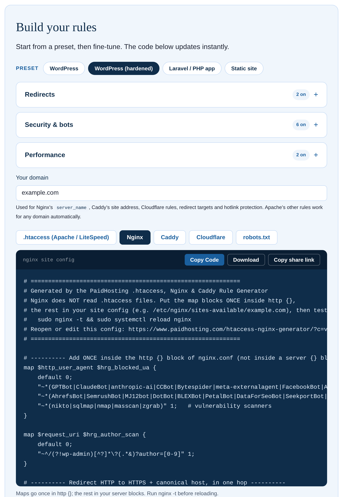

# Server Rules Generator

Generate matching rules for **Apache / LiteSpeed (.htaccess), Nginx, Caddy and Cloudflare** from one set of switches: HTTPS and www redirects, bulk redirects, security headers, AI crawler and bad bot blocking, WordPress hardening, caching, WebP and more.

**[Try it live →](https://www.paidhosting.com/htaccess-nginx-generator/)**

## What it does that most generators don't

- **Four servers from the same switches.** Most snippets online are written for one server and quietly break when copied to another. This writes the equivalent rules for each.
- **Fixes your redirect list.** Chains (`/a → /b`, `/b → /c`) are shortened so every old URL goes to its final address in one hop. Lines that loop back on each other are removed and flagged.
- **Current AI crawler blocking**, split into training crawlers (GPTBot, ClaudeBot, CCBot…) and AI search and assistant fetchers, so you can block one group and keep the other. Includes the matching `robots.txt`.
- **Domain moves, removing `.php` / `.html` from URLs, and password-protected folders**, done safely: forms that post to a `.php` file keep working, and `/.well-known/` stays open so SSL certificates still renew.
- **Correct order.** HTTPS and www are combined into a single redirect, and every block lands where that server needs it.
- **Share links** that restore an exact setup. Usernames and passwords are never included.

Everything runs in your browser. Nothing you type is sent anywhere.

## What each server gets

| Feature | Apache / LiteSpeed | Nginx | Caddy | Cloudflare |
| --- | --- | --- | --- | --- |
| Force HTTPS + canonical www | ✓ | ✓ | ✓ | Settings to switch on |
| Trailing slash, remove .php/.html | ✓ | ✓ | ✓ | Keep server rules |
| Bulk redirects (chains fixed) | ✓ | ✓ | ✓ | Bulk Redirects list (CSV) |
| Move from an old domain | ✓ | ✓ | ✓ | Bulk Redirects list (CSV) |
| Security headers, HSTS, CSP | ✓ | ✓ | ✓ | Keep server rules |
| AI crawler and bad bot blocking | ✓ | ✓ | ✓ | WAF custom rules |
| Sensitive files, WordPress hardening | ✓ | ✓ | ✓ | WAF custom rules |
| IP blocking | ✓ | ✓ | ✓ | WAF custom rule |
| Password-protected folder | ✓ | ✓ | ✓ | Keep server rules |
| Compression, caching, WebP | ✓ | ✓ | ✓ | Keep server rules |
| Hotlink protection | ✓ | ✓ | ✓ | Setting to switch on |
| Custom error pages | ✓ | ✓ | ✓ | Keep server rules |

## Examples

Ready-made output for six common setups is in [`examples/`](examples). Every file was produced by the generator itself, for `example.com`:

1. [HTTPS and www](examples/01-https-and-www)
2. [Security headers](examples/02-security-headers)
3. [Block AI crawlers and bad bots](examples/03-block-ai-crawlers-and-bad-bots)
4. [WordPress hardening](examples/04-wordpress-hardening)
5. [WebP images](examples/05-webp-images)
6. [Bulk redirects with a chain fixed](examples/06-bulk-redirects-chain-fixed)

Each file starts with a link that reopens that exact setup in the live generator, so you can change it for your own domain.

## Where to put the rules

- **Apache / LiteSpeed:** at the top of your `.htaccess`. On WordPress, above the `# BEGIN WordPress` block, never inside it.
- **Nginx:** the `map` blocks once inside `http {}`, the rest in your site's `server {}` block. Run `sudo nginx -t` before reloading.
- **Caddy:** in your Caddyfile, inside the site block. Run `caddy validate` before reloading.
- **Cloudflare:** each rule is a WAF custom rule (Security > Security rules). Redirect lists are imported in Bulk Redirects.

Always back up your current config first.

## How it was tested

Every output was run on real servers before launch: Apache 2.4, Nginx 1.24, Caddy 2.10, a LiteSpeed shared host, and a real Cloudflare account. See [TESTING.md](TESTING.md).

## Run it locally

Open [`src/index.html`](src/index.html) in a browser. It's the same generator as the live page, with no build step and no dependencies. The maintained version is always at [paidhosting.com/htaccess-nginx-generator](https://www.paidhosting.com/htaccess-nginx-generator/).

## Contributing

Found a rule that misbehaves on your server? Open an issue with your server type and version, the share link from the generator, and what happened. Fixes to the bot lists are especially welcome.

## License

[MIT](LICENSE). Made by [PaidHosting.com](https://www.paidhosting.com/).
